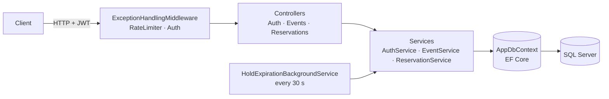
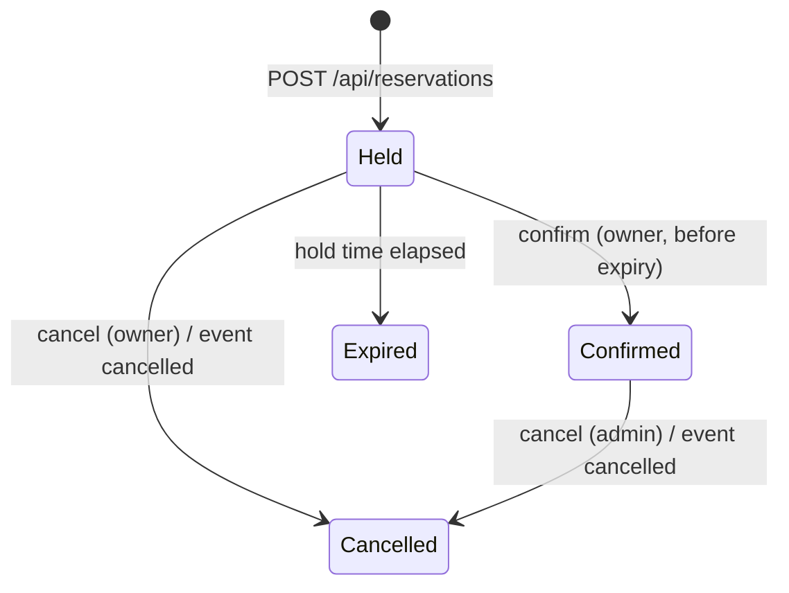

# TicketDesk API

> Event ticketing backend with limited capacity: self-expiring holds, purchase confirmation and oversell protection under real concurrency.

[](https://github.com/edu-tech220/ticketdesk-api/actions/workflows/ci.yml)


## 📌 Overview

TicketDesk is a REST API for selling event tickets with limited capacity: ticket tiers, temporary
reservations ("holds") that expire on their own, purchase confirmation and oversell control under
real concurrency.

Selling limited tickets has a classic concurrency problem: if two buyers try to reserve the last
ticket at the same moment, a naive system can sell it twice. TicketDesk solves this with a
**two-step reservation flow**:

1. **Hold** — the buyer sets aside `N` tickets of a tier for a limited time (10 minutes by
   default). Availability is decremented immediately so nobody else can take them.
2. **Confirm** — the buyer confirms the hold before it expires. If they don't, a
   `BackgroundService` releases the tickets automatically so they become available again.

## ✨ Key features and business rules

- **Oversell protection under concurrency** — two simultaneous requests on the same tier compete
  for the same row; one wins and the other retries with fresh data, or gets a `409` if there is no
  capacity left. Availability never goes below zero.
- **Reservation state machine** — `Held → Confirmed | Expired | Cancelled`. Each transition checks
  who may perform it and under which conditions (owner, admin, time remaining):
  - only the owner can confirm, and only while the hold is `Held` and not expired;
  - the owner can cancel a `Held` reservation; a `Confirmed` one can only be cancelled by an admin.
- **Automatic hold expiry** — a `BackgroundService` scans expired holds every 30 seconds and
  returns their tickets to the pool without manual intervention.
- **Anti-hoarding limits** — a maximum number of tickets per request (6) and a maximum of active
  tickets per user and tier (6), plus a rate limit on the hold endpoint to slow down bots.
- **Event lifecycle** — an event starts as `Draft`, can only be published if it has at least one
  ticket tier, and when cancelled it cascades: all its active reservations are cancelled and their
  tickets released. Holds are rejected for unpublished or already-started events.
- **Pagination and filtering** on the public event listing (filter by status, page size capped at 50).

## 🏗️ Architecture

Layering is **Controller → Service → DbContext**. Controllers contain no business logic; the
concurrency, validation and state-transition rules live in the services, which are the most
heavily tested part of the codebase.





## 🧠 Technical decisions

- **Application-managed concurrency token instead of a database one.** Rather than SQL Server's
  `rowversion` (which SQLite does not support), `TicketTier` and `Reservation` have a `Version`
  column configured with `IsConcurrencyToken()` that `AppDbContext` increments on every
  `SaveChanges`. The result is the same optimistic control (EF throws
  `DbUpdateConcurrencyException` if someone else modified the row first), and it behaves the same
  on SQL Server (production) and SQLite (tests) without per-provider logic.
- **Bounded retries instead of pessimistic locks.** `ReservationService.CreateHoldAsync` retries up
  to `MaxConcurrencyRetries` times, re-reading the tier when it collides with a concurrent write,
  instead of locking the row. It is simpler to reason about and avoids deadlocks for a domain of
  this size.
- **In-process polling for expiry, not SQL Agent or an external cron.** A `BackgroundService` in
  the API process releases expired holds every 30 seconds. At this scope it is simpler than
  coordinating an external job and needs no extra infrastructure.
- **Custom PBKDF2 instead of ASP.NET Core Identity.** Identity brings far more than this domain
  needs (2FA, UI, etc.). A PBKDF2 hasher (100,000 iterations) plus hand-rolled JWT covers the use
  case with fewer moving parts.
- **Uniform `ProblemDetails` via middleware.** Domain exceptions (`NotFoundException` → 404,
  `ConflictException` → 409, `ValidationException` → 422, `ForbiddenException` → 403,
  `UnauthorizedException` → 401) and `DbUpdateConcurrencyException` (→ 409) are mapped to HTTP
  status codes and a consistent `application/problem+json` body in `ExceptionHandlingMiddleware`,
  so no controller repeats `try/catch`.
- **Per-user rate limiting.** The hold endpoint uses a fixed-window policy of 10 requests per
  10 seconds, partitioned by authenticated user (falling back to the client IP).
- **Options pattern for business limits.** Hold duration, per-request and per-user limits and the
  retry count are configured in the `Reservations` section of `appsettings.json`.

## 🧰 Tech stack

| Area | Technology |
|---|---|
| Language / runtime | C# · .NET 8 |
| Web | ASP.NET Core Web API (controllers), Swagger / OpenAPI (Swashbuckle) |
| Data access | Entity Framework Core 8 (code-first migrations) |
| Database | SQL Server 2022 (SQLite in tests) |
| Background work | `BackgroundService` (hosted service) |
| Security | JWT Bearer, PBKDF2, ASP.NET Core rate limiting |
| Testing | xUnit, `WebApplicationFactory` |
| DevOps | Docker, Docker Compose, GitHub Actions |

## 🚀 Getting started

### With Docker Compose (API + SQL Server)

```bash
docker compose up --build
```

The API is available at `http://localhost:8080`, with Swagger UI at
`http://localhost:8080/swagger` (the compose file runs the `Development` environment). On startup
it applies pending migrations and creates a bootstrap admin user from `AdminSeed:Email` /
`AdminSeed:Password` (defaults: `admin@ticketdesk.local` / `ChangeMe123!`, overridable through
environment variables).

> These credentials and the JWT signing key are sample values only — change them before using
> the API in any real environment.

### Locally (without Docker)

Requires the .NET 8 SDK and a reachable SQL Server instance (set
`ConnectionStrings:DefaultConnection` in `appsettings.Development.json` or through an environment
variable).

```bash
dotnet restore
dotnet run --project src/TicketDesk.Api
```

With the default `http` launch profile the API runs on `http://localhost:5081` (Swagger at
`/swagger`).

### Configuration

| Key | Default | Purpose |
|---|---|---|
| `Reservations:HoldDurationMinutes` | `10` | How long a hold reserves tickets |
| `Reservations:MaxQuantityPerHold` | `6` | Max tickets per hold request |
| `Reservations:MaxActiveTicketsPerUserPerTier` | `6` | Max held + confirmed tickets per user and tier |
| `Reservations:MaxConcurrencyRetries` | `3` | Retries on optimistic-concurrency conflicts |
| `Jwt:*` | — | Issuer, audience, signing key, expiration |
| `AdminSeed:*` | — | Bootstrap admin credentials |

## 🧪 Running tests

```bash
dotnet test
```

The suite has **31 tests** and needs neither SQL Server nor Docker: it uses SQLite (a temporary
file) and `WebApplicationFactory` to run the full API in memory.

| Area | File | What it covers |
|---|---|---|
| Reservations | `Unit/ReservationServiceTests.cs` | Holds, confirmation, cancellation, expiry, limits — including **20 concurrent buyers against a tier with 5 tickets**, asserting exactly 5 succeed and nothing is oversold |
| Events | `Unit/EventServiceTests.cs` | Event lifecycle (draft, publish, cancel cascade) |
| Auth | `Unit/AuthServiceTests.cs` | Registration and login |
| Security | `Unit/Pbkdf2PasswordHasherTests.cs`, `Unit/JwtTokenServiceTests.cs` | Password hashing and JWT generation |
| End-to-end | `Integration/TicketDeskEndToEndTests.cs` | Create event → add tier → publish → hold → confirm → cancel event; 401/403 authorization; `429` from the hold rate limit |

CI (`.github/workflows/ci.yml`) restores, builds and tests the solution on every push and pull
request to `main`, then builds the Docker image.

## 📡 API endpoints

| Method | Route | Access | Description |
|---|---|---|---|
| POST | `/api/auth/register` | Public | Register a customer |
| POST | `/api/auth/login` | Public | Get a JWT (the bootstrap admin logs in here too) |
| GET | `/api/events` | Public | Paginated event list, filterable by status |
| GET | `/api/events/{eventId}` | Public | Event details with tiers |
| POST | `/api/events` | Admin | Create an event in `Draft` |
| POST | `/api/events/{eventId}/tiers` | Admin | Add a ticket tier (name, price, quota) |
| POST | `/api/events/{eventId}/publish` | Admin | Publish (requires at least one tier) |
| POST | `/api/events/{eventId}/cancel` | Admin | Cancel the event and release all reserved tickets |
| POST | `/api/reservations` | Authenticated | Create a hold (rate-limited) |
| POST | `/api/reservations/{reservationId}/confirm` | Owner | Confirm the purchase before the hold expires |
| POST | `/api/reservations/{reservationId}/cancel` | Owner (hold) / Admin (confirmed) | Cancel a reservation |
| GET | `/api/reservations/mine` | Authenticated | The current user's reservations, paginated |

## 📁 Project structure

```
.
├── .github/workflows/ci.yml       # Build, test and Docker image build
├── Dockerfile                     # Multi-stage build, runs as non-root user on port 8080
├── docker-compose.yml             # API + SQL Server 2022
├── TicketDesk.slnx
├── src/TicketDesk.Api/
│   ├── BackgroundServices/        # HoldExpirationBackgroundService
│   ├── Common/                    # Domain exceptions, ProblemDetails middleware, rate-limit policies
│   ├── Controllers/               # Auth, Events, Reservations (thin, delegate to services)
│   ├── Data/                      # AppDbContext + EF Core migrations
│   ├── Domain/
│   │   ├── Entities/              # User, Event, TicketTier, Reservation
│   │   └── Enums/                 # UserRole, EventStatus, ReservationStatus
│   ├── Dtos/                      # Request/response contracts per resource
│   ├── Security/                  # JWT, PBKDF2 hashing, current user from the token
│   ├── Services/                  # Business rules (AuthService, EventService, ReservationService)
│   └── Program.cs
└── tests/TicketDesk.Tests/
    ├── Integration/               # End-to-end tests with WebApplicationFactory
    ├── TestUtils/                 # SQLite test database, test data builder
    └── Unit/                      # Service, hasher and token tests
```
